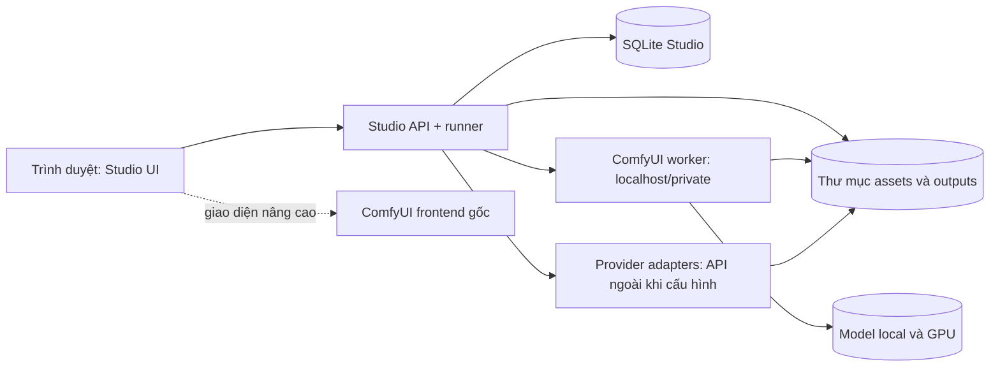

# Hạ tầng Studio dựa trên ComfyUI

Trạng thái: thiết kế để triển khai, chưa xây Studio. Phạm vi hiện tại là năm chức năng F01–F05 trong [FUNCTIONS.md](FUNCTIONS.md): Text → Image, Image → Image, Image → Video, Text → Video, Video → Video. Civitai (tìm/tải model, nhập prompt và cloud generation) được tạm hoãn. Không yêu cầu đăng nhập trong ứng dụng ở bản nội bộ.

## 1. Đã đủ cơ sở để làm gì?

**Đủ** để thiết kế dữ liệu flow, giao diện Studio, quản lý file, hàng đợi và đường tích hợp ComfyUI. **Chưa đủ** để cam kết thông số/chi phí/khả năng của mọi model: mỗi chức năng cần chọn ít nhất một workflow hoặc API cụ thể rồi kiểm thử đầu vào, đầu ra và phần cứng. Từ đầu dùng một catalog capability rõ ràng để thêm model dần, thay vì một form cố định cho tất cả.

| Có sẵn trong repo | Cần xây cho Studio |
| --- | --- |
| Engine graph, node loader, model management, queue | Graph ở mức tác vụ dễ hiểu, mapping sang workflow/node thật |
| `POST /prompt`, `GET /object_info`, `/ws`, `/history/{prompt_id}`, `/queue`, `/interrupt` trong `server.py` | API dự án, run, step, kết quả và phục hồi sau mất kết nối |
| `POST /upload/image`, `POST /upload/mask`, `LoadImage`, `SaveImage` | Upload video, thư viện media thống nhất, mask editor, kiểm tra file |
| `LoadVideo`, `SaveVideo`, xử lý video trong `comfy_extras/nodes_video.py` | Preview video, timeline cơ bản, quản lý codec/FPS/audio, kết quả video |
| Node T2V/I2V/first-last/reference và một số V2V qua local hoặc Comfy API proxy | Preset được kiểm thử cho từng mode, key/provider adapter nếu cần BYOK |
| `--front-end-root`, `--input-directory`, `--output-directory` | Giao diện Studio riêng và cài đặt lưu trữ thân thiện |

Không sửa `execution.py`, model loader hoặc node core chỉ để truyền ID UI, lưu lịch sử Studio hay gọi API ngoài. Giữ giao diện ComfyUI gốc cho chế độ nâng cao.

## 2. Bố cục hệ thống



**Studio UI** chỉ hiển thị thẻ, cổng, menu và kết quả; không có API key hay đường dẫn server bí mật. **Studio API/runner** sở hữu dự án, media, jobs, mapping node UI ↔ node Comfy, adapter và key. **ComfyUI worker** nhận workflow hợp lệ qua API hiện tại, sử dụng GPU/model local, trả trạng thái và file. **Provider adapter** là đường riêng cho model dùng key chính chủ; không đặt outbound Internet trong core ComfyUI.

Ở bản đầu có thể chạy Studio API và ComfyUI trên cùng một máy, nhưng là hai ranh giới logic rõ. Giao diện Studio phục vụ ở `/studio`; ComfyUI frontend gốc vẫn truy cập riêng cho workflow nâng cao. Khi lên VPS, các thành phần vẫn có thể đặt cùng máy hoặc tách worker GPU ra máy khác mà không thay định dạng flow.

## 3. Catalog chức năng/model

Mỗi lựa chọn chạy được khai báo bằng một mục nhỏ: `mode` (F01–F05), `backend` (`comfy_local`, `comfy_proxy`, `provider_direct`), `model_id`, `input_ports`, `output_type`, `parameters`, `requirements`, `availability`. Catalog là nguồn để UI dựng form và server kiểm tra flow.

Ví dụ: một preset I2V có `prompt` tùy chọn, `start_image` bắt buộc và `end_image` tùy chọn; một preset khác có thể chỉ nhận ảnh đầu. Với V2V, catalog phải nói rõ nhận `source_video`, có dùng prompt không, có giữ audio không và giới hạn file thực của backend. `GET /object_info` giúp kiểm tra node ComfyUI có được đăng ký, nhưng không thay thế bản khai báo UX vì tên input node không luôn là khái niệm thân thiện với người dùng.

Không hiện preset là `Sẵn sàng` nếu thiếu model local, key, GPU phù hợp hoặc workflow chưa kiểm thử. Dùng `Chưa cấu hình`, `Cần GPU khác`, `Sẵn sàng` theo kết quả kiểm tra thực.

## 4. Dữ liệu và file

- SQLite **riêng cho Studio** lưu `projects`, `pages/graphs`, `assets`, `runs`, `run_steps`, `model_presets` và cấu hình không bí mật. Graph là JSON có version, node IDs, edge IDs, tọa độ và tham số. Mỗi run giữ snapshot bất biến của graph/model/params.
- File media thật ở filesystem: `imports/`, `outputs/`, `previews/`, có thể thêm `temp/`. Database chỉ giữ metadata, vị trí, loại, kích thước, thời lượng/FPS và checksum khi cần. Không nhét video vào SQLite.
- API Assets hiện tại của ComfyUI là tính năng tùy chọn (`--enable-assets`) và trong code được ghi là chưa hoàn thiện. Studio không phụ thuộc vào schema/API đó cho dữ liệu cốt lõi; có thể tận dụng sau khi kiểm chứng ổn định.
- Đường dẫn ComfyUI input/output dùng qua cấu hình có sẵn. Studio cho chọn nơi lưu kết quả mới nhưng server phải kiểm tra path, quyền ghi và ánh xạ file kết quả. Trên VPS, `Mở thư mục` được thay bằng `Tải xuống` và thông tin vị trí phía server.
- API key lưu server-side trong secret store phù hợp môi trường, không lưu trong graph, URL, localStorage, lịch sử hoặc log. UI chỉ nhận trạng thái đã cấu hình; mỗi provider có ô riêng.

## 5. Đường chạy cho năm chức năng

```text
Nhập media/prompt -> chọn chức năng và preset -> kiểm tra cổng
-> chụp snapshot -> tạo run -> chọn backend
-> gửi tới ComfyUI hoặc provider -> theo dõi/poll
-> xác minh file đầu ra -> lưu asset -> cập nhật thẻ và lịch sử
```

| Mode | Workflow/adapter khởi đầu | Vấn đề riêng cần giải quyết |
| --- | --- | --- |
| F01 Text → Image | Một preset ComfyUI local được kiểm thử | Prompt, seed, tỉ lệ, lưu metadata tái tạo |
| F02 Image → Image | Một preset ComfyUI local hoặc API edit | Upload ảnh, mức thay đổi, tham chiếu, so sánh trước/sau |
| F03 Image → Video | Một preset I2V local nếu đủ máy, hoặc provider/API | Ảnh đầu/cuối, upload media đến backend, job dài, poster |
| F04 Text → Video | Một preset T2V local nếu đủ máy, hoặc provider/API | Job dài, thời lượng, độ phân giải, timeout/poll |
| F05 Video → Video | Chọn **một** hành vi V2V cụ thể và adapter đã kiểm thử | Video nguồn, codec/FPS/audio, kích thước, ngữ nghĩa của prompt |

Repo hiện có node V2V như Kling Omni, Runway Aleph2 và conditioning Bernini, nhưng tên node không đồng nghĩa với quyền dùng API, key riêng hay khả năng chạy trên máy hiện tại. Chọn một tuyến F05 sau khi thử request/response, chi phí và giới hạn media. Các node Seedance/Nano Banana trong repo chủ yếu đi qua Comfy API proxy; BYOK Google/ByteDance yêu cầu adapter riêng.

## 6. Queue và trạng thái

- Studio tạo `run_id`, từng bước có `step_id`. ComfyUI trả `prompt_id`; provider có thể trả `task_id`. Ánh xạ nằm trong Studio DB/API, không đi vào engine ComfyUI.
- Một chuỗi thuần ComfyUI có thể biên dịch thành một prompt graph. Chuỗi pha local/API được chia stage, trao đổi qua asset đã lưu. Bản đầu chạy một stage tại một thời điểm cho mỗi run để tránh trùng và kiểm soát GPU/chi phí.
- Trạng thái chuẩn: `waiting`, `queued`, `running`, `succeeded`, `failed`, `cancel_requested`, `cancelled`. Chỉ báo tiến độ phần trăm khi backend cung cấp số đo thật.
- Mất WebSocket thì đọc lại `/queue` và `/history/{prompt_id}`; Studio DB giữ lịch sử lâu dài vì lịch sử queue trong ComfyUI không phải kho dữ liệu sản phẩm. Khi restart, runner đối chiếu job đang dở trước khi retry để tránh gọi API trả phí hai lần.
- Hủy theo `prompt_id` với ComfyUI và theo `task_id` nếu provider hỗ trợ. Không ngắt toàn bộ hàng đợi vì một nút Hủy. Lỗi gắn vào đúng step/thẻ, giữ input để chạy lại.

## 7. Cần chỉnh sửa ComfyUI bao nhiêu?

**Mức khuyến nghị: thay rất ít.** Dùng API và node hiện có làm worker. Việc chính nằm ở Studio UI, Studio API, preset compiler và provider adapters bên ngoài core. Chỉ thêm custom node hẹp khi một workflow đã chọn thực sự thiếu một phép xử lý local mà node hiện có không làm được. Không fork và viết lại frontend ComfyUI mặc định; nếu cần đổi frontend root, vẫn giữ một đường truy cập frontend gốc.

| Lớp | Công việc cụ thể | Có cần sửa core? |
| --- | --- | --- |
| Studio frontend | Canvas kiểu Magnific, cổng `T`/ảnh/video, asset viewer, form model | Không |
| Studio API | CRUD project/graph, catalog, file upload/download, settings | Không |
| Flow compiler | Chuyển 5 loại thẻ đã hỗ trợ sang prompt ComfyUI hoặc yêu cầu provider | Không |
| Job runner | Queue, mapping ID, sự kiện, hủy, retry, lưu kết quả | Không |
| ComfyUI worker | Chạy workflow, load model, quản lý VRAM, ghi file | Dùng sẵn |
| Model/API đặc thù | Preset hoặc adapter per provider; custom node chỉ khi có lý do rõ | Có thể, nhưng hẹp |

## 8. Local, VPS và điều kiện vận hành

- Local: Studio API, ComfyUI, SQLite và file storage trên cùng máy. GTX 1650 4 GB chỉ đánh dấu preset local nào đã kiểm thử; các preset video nặng chuyển sang provider hoặc worker GPU khác. Không tự động chuyển backend khi người dùng chưa biết vì có thể phát sinh chi phí.
- VPS chỉ CPU: có thể host giao diện, API, DB và file, nhưng không tự biến thành máy chạy model GPU. Cần VPS GPU, worker GPU riêng hoặc provider API cho tác vụ nặng. ComfyUI worker không nên mở trực tiếp ra Internet; Studio API là đầu vào duy nhất của ứng dụng.
- Không đăng nhập trong ứng dụng: khi truy cập từ ngoài, dùng giới hạn mạng/VPN/reverse proxy có xác thực ở lớp triển khai. Secret API và file người dùng vẫn được bảo vệ.
- Một người dùng và một worker bắt đầu với SQLite + filesystem. Khi có nhiều người dùng/worker hoặc nhiều máy ghi cùng lúc mới đánh giá PostgreSQL/object storage; không thêm sớm.

## 9. Những quyết định cần chốt trước khi viết adapter

1. Chọn một preset/model chạy được cho từng F01–F05, và ghi rõ `local / Comfy proxy / BYOK provider`.
2. Với F05, định nghĩa lần đầu là `biến đổi video theo prompt`, `nâng cấp video`, hay tác vụ khác; một tên chung chưa đủ để lập request.
3. Quy định file ảnh/video đầu vào chấp nhận, output mặc định, cách xử lý âm thanh trong F03–F05 và giới hạn thực của provider.
4. Chốt việc dùng Comfy API proxy sẵn có hay key chính chủ cho từng provider. Hai tuyến có auth, giá và adapter khác nhau.

Các quyết định này **không cản** việc bắt đầu xây Studio shell, graph storage, file library, job state, catalog, và một workflow F01/F02 local. Chúng chỉ cản việc cam kết F03–F05 chạy qua model cụ thể.

## 10. Trình tự triển khai

Xem [IMPLEMENTATION_PLAN.md](IMPLEMENTATION_PLAN.md) để theo dõi giai đoạn, phụ thuộc và tiêu chí nghiệm thu. Civitai không nằm trong kế hoạch hiện tại.
