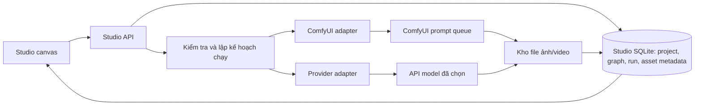

# Thiết kế flow logic cho Studio

Trạng thái: bản thiết kế logic chạy; Studio hiện đã có canvas, graph API, thư viện media và runner cho Text → Image cùng Image → Image local. Runner đang đọc `/queue` và `/history` theo chu kỳ, chưa dùng `/ws`; chưa có checkpoint trên máy để nghiệm thu bằng model thật. Kết quả mới có thể chọn thư mục lưu trên máy chạy Studio. Danh mục chức năng trong [FUNCTIONS.md](FUNCTIONS.md) quyết định từng adapter và đầu vào/đầu ra. Civitai được tạm hoãn. Mục tiêu tiếp theo là nghiệm thu chuỗi `nguồn -> tác vụ -> kết quả` với checkpoint thật trên máy nội bộ, sau đó mới mở rộng nhiều nhánh và VPS.

## 1. Điểm xuất phát trong repository

- ComfyUI nhận workflow qua `POST /prompt`, trả `prompt_id`; có WebSocket `/ws`, `GET /history/{prompt_id}`, `GET /queue`, `POST /interrupt` và `POST /upload/image` trong `server.py`.
- API Assets dưới `app/assets/api/routes.py` có upload, danh sách, lấy nội dung, nhưng được bật có điều kiện bằng `--enable-assets` và chính mã nguồn ghi rằng hệ này chưa hoàn thiện. Không xây dữ liệu cốt lõi của Studio dựa vào hợp đồng API Assets đó trước khi kiểm chứng.
- Node Nano Banana/Gemini và Seedance đã có trong `comfy_api_nodes`, nhưng nhiều node dùng `IO.Hidden.api_key_comfy_org` và endpoint `/proxy/...`. Đây là tuyến thanh toán/xác thực qua Comfy API, **khác** với nhập key Google/ByteDance trực tiếp. Thiết kế phải ghi rõ tuyến nào được chọn; không dùng một key cho mọi provider.
- Theo `AGENTS.md`, không đưa truy cập Internet mới vào lõi ComfyUI. Bộ điều phối Studio và adapter provider thuộc lớp ứng dụng riêng; `execution.py` chỉ thực thi graph ComfyUI.

## 2. Luồng tổng quát



**Ranh giới:** Studio sở hữu ID dự án, ID thẻ, dây nối, vị trí trên canvas, lịch sử và asset. ComfyUI chỉ nhận prompt graph và trả kết quả/trạng thái thực thi. Mapping giữa ID Studio và `prompt_id` nằm tại Studio API/adapter, không đi vào `execution.py` hoặc model loader.

## 3. Dữ liệu của một flow

Mỗi project có các page; mỗi page lưu `nodes`, `edges`, `viewport` và `version`. Dữ liệu trình bày như tọa độ, kích thước, trạng thái mở/đóng thuộc page UI. Dữ liệu thực thi như loại tác vụ, model, tham số và kết nối thuộc flow. Lưu bản nháp tự động sau thay đổi và tăng `version` khi graph thay đổi.

```json
{
  "version": 1,
  "nodes": [
    {"id": "image-a", "kind": "asset.image", "asset_id": "...", "x": 80, "y": 180},
    {"id": "text-a", "kind": "text", "value": "Chuyển thành tranh màu nước", "x": 80, "y": 520},
    {"id": "edit-a", "kind": "image.edit", "model_ref": "provider/model", "params": {}, "x": 520, "y": 220}
  ],
  "edges": [
    {"from": ["image-a", "image"], "to": ["edit-a", "source_image"]},
    {"from": ["text-a", "text"], "to": ["edit-a", "prompt"]}
  ]
}
```

`kind` là hành động ổn định của Studio; `model_ref` chọn cách thực thi cụ thể. Không lưu API key hoặc đường dẫn tuyệt đối trong graph. Mỗi model có khai báo khả năng: input/output type, cổng bắt buộc/tùy chọn, số lượng được nhận, tham số hợp lệ, loại backend (`comfy_local`, `comfy_proxy`, `provider_direct`). Đây là một danh mục rõ ràng, không suy diễn hành vi từ tên model.

## 4. Quy tắc nối dây và kiểm tra

1. Khi kéo dây, frontend dùng khai báo cổng để chỉ tô sáng đích tương thích. Server kiểm tra lại trước khi lưu và trước khi chạy; không tin vào dây gửi từ trình duyệt.
2. So loại dữ liệu: `text`, `image`, `video`, `audio`, `3d`. Cổng có cùng loại vẫn phải đúng vai trò và số lượng tối đa. Không tự đổi ảnh thành video hoặc ngược lại nếu chưa có adapter rõ ràng.
3. Cấm cycle cho bản đầu. Tìm thứ tự topo để chạy; trả lỗi tại dây tạo cycle.
4. Kiểm tra input bắt buộc, model đã chọn, key/khả năng chạy, asset còn tồn tại và tệp đọc được. Các giới hạn mang tính chất lượng chỉ cảnh báo khi backend vẫn nhận input; giới hạn thực của API/backend mới chặn.
5. Kiểm tra tương thích lại khi đổi model. Nêu cổng/dây sẽ bị ảnh hưởng, không xóa im lặng.

## 5. Một lần chạy diễn ra thế nào

1. Người dùng bấm `Chạy` trên một thẻ hoặc `Chạy flow`. Bản đầu ưu tiên `Chạy thẻ này`: hệ thống tìm các thẻ nguồn ở phía trước mà nó cần.
2. Studio API tạo **snapshot bất biến** của graph/version, model và tham số cho lần chạy. Sửa canvas sau đó không làm thay đổi job đang chạy.
3. Validator trả lỗi cụ thể theo thẻ/cổng nếu thiếu đầu vào, key, model hoặc tệp.
4. Planner sắp xếp các thẻ cần thực thi theo thứ tự topo. Asset/text là nguồn; tác vụ đã có kết quả còn hợp lệ có thể tái sử dụng; thẻ thay đổi hoặc có nguồn mới phải chạy lại.
5. Runner tạo `run_id` và từng `step_id`, lưu trạng thái `queued`, phát sự kiện trạng thái cho frontend. Mỗi step được điều phối tới ComfyUI adapter hoặc provider adapter theo `model_ref`.
6. Kết quả của step được kiểm tra loại, chép/ghi vào kho file và tạo asset metadata. Step sau nhận `asset_id`/đường dẫn nội bộ qua adapter; không dùng URL preview của trình duyệt làm đầu vào model.
7. Khi hoàn tất, lưu mapping từ run/step tới asset; frontend hiển thị kết quả tại đúng thẻ và trong Assets/Tác vụ. Nếu thất bại, giữ graph, input và các kết quả step đã thành công để chạy lại.

**Quy tắc tái chạy:** khi prompt, tham số, model hoặc asset nguồn của một thẻ đổi, đánh dấu kết quả thẻ đó và các thẻ phụ thuộc là `cũ`. Bản đầu có thể so chữ ký của input + model + tham số theo từng thẻ. Không cần cache tensor hoặc state trên model ComfyUI.

## 6. Hai đường thực thi model

| Đường | Khi nào dùng | Cách chạy | Key |
| --- | --- | --- | --- |
| `comfy_local` | Model/flow chạy trên GPU local hoặc worker VPS | Adapter tạo prompt ComfyUI, gửi `/prompt`, theo dõi `/ws` và kiểm tra `/history/{prompt_id}` | Không có provider key |
| `comfy_proxy` | Dùng node API có sẵn của ComfyUI | Prompt chứa node Comfy API tương ứng; hiện rõ đây là tuyến Comfy | Khóa/điều kiện của Comfy API, không giả làm key provider |
| `provider_direct` | Người dùng muốn key chính chủ Google, ByteDance hoặc provider khác | Adapter riêng gửi yêu cầu đến API chính thức, theo dõi task bất đồng bộ, tải kết quả về kho file | Key riêng của đúng provider, lưu ở server |

Ở MVP, mỗi thẻ tác vụ dùng đúng một adapter. Flow kết hợp local + provider chạy từng stage qua Studio runner; ranh giới stage truyền ảnh/video dạng file/asset. Không cố nhồi toàn bộ provider call vào `execution.py`. Chỉ thêm adapter khi đã xác minh API chính thức, định dạng request/response, quyền sử dụng và quy trình lấy key của provider đó.

Với chuỗi chỉ dùng node ComfyUI, có thể biên dịch nhiều thẻ thành **một** prompt ComfyUI để tránh tải/ghi file trung gian. Với flow hỗn hợp, chia tại ranh giới provider và lưu media trung gian. Bản đầu triển khai một chuỗi nhỏ đã kiểm thử trước khi hỗ trợ nhánh phức tạp.

## 7. Theo dõi, hủy và lỗi

| Trạng thái step | Ý nghĩa |
| --- | --- |
| `waiting` | Đợi step đầu vào |
| `queued` | Đã gửi tới backend hoặc hàng đợi Studio |
| `running` | Backend xác nhận đang xử lý |
| `succeeded` | Đã lưu và kiểm tra asset đầu ra |
| `failed` | Có lỗi cụ thể và có thể chạy lại |
| `cancel_requested` | Đã yêu cầu dừng, đang chờ backend phản hồi |
| `cancelled` | Backend đã dừng hoặc kết quả bị bỏ theo yêu cầu |

ComfyUI trả `prompt_id`; Studio lưu ánh xạ `run_id/step_id -> prompt_id`, nhận sự kiện `/ws`, rồi đối chiếu `/history/{prompt_id}` sau khi hoàn thành hoặc khi WebSocket mất kết nối. Dùng hủy theo `prompt_id` cho job đang chạy và xóa theo ID với job còn chờ. Không gọi ngắt toàn bộ queue khi người dùng chỉ muốn hủy một job. Provider bất đồng bộ lưu `provider_task_id` và polling theo chính sách của API đó; nút Hủy chỉ hứa hủy từ xa nếu provider hỗ trợ.

Lỗi UI trỏ tới thẻ và bước gây lỗi: `Thiếu API key Google`, `Model local chưa cài`, `Provider hết quota`, `Ảnh đầu vào không đọc được`, `GPU hết bộ nhớ`, `Tác vụ quá thời gian`. Không đổi lỗi thành `Có lỗi xảy ra` chung chung. Retry chỉ chạy lại step lỗi và phần phụ thuộc khi input không đổi.

## 8. Lưu trữ và database

- File ảnh/video/model nằm trên filesystem hoặc object storage khi cần; database lưu metadata và tham chiếu, **không** chứa blob video lớn. Với một người dùng và một worker, SQLite riêng cho Studio là đủ để bắt đầu. Không dựa vào bảng Assets hiện có của ComfyUI vì API đó còn được đánh dấu chưa ổn định.
- Bảng tối thiểu: `projects` (tên, thời gian), `pages` (graph JSON + version), `assets` (loại, vị trí, hash, nguồn, kích thước), `runs` (snapshot/version, trạng thái), `run_steps` (node, backend, prompt/task ID, trạng thái, lỗi, output asset IDs).
- API key không ghi plaintext vào graph, history, log hoặc trường assets. Bản local dùng kho bí mật do server quản lý; khi lên VPS phải có cách cấp secret và bảo vệ truy cập ngoài ứng dụng. UI chỉ nhận trạng thái key và bốn ký tự cuối nếu cần.
- Cho chọn thư mục **kết quả mới** qua Cài đặt. Đường dẫn tuyệt đối được kiểm tra ở server; trên VPS thư mục đó là của server, trình duyệt dùng nút tải về. Thay thư mục không tự chuyển dữ liệu cũ.
- Sau khi hoàn thành năm chức năng lõi, Civitai/custom node có thể trở thành một flow quản trị riêng: người dùng yêu cầu -> xác định artifact và đích -> tải -> kiểm tra -> cài/kích hoạt -> cập nhật danh mục. Phần này không thuộc hạ tầng cần triển khai hiện tại.

## 9. API Studio tối thiểu cần xây

| Nhóm | Endpoint dự kiến | Mục đích |
| --- | --- | --- |
| Projects/pages | `GET/POST /studio/projects`, `GET/PUT /studio/pages/{id}` | Mở và lưu graph có version |
| Catalog | `GET /studio/catalog` | Thẻ, cổng, model, tham số và tình trạng sẵn sàng |
| Assets | `POST/GET /studio/assets`, `GET /studio/assets/{id}/content` | Nhập, liệt kê, đọc media |
| Runs | `POST /studio/runs`, `GET /studio/runs/{id}`, `POST /studio/runs/{id}/cancel` | Chạy, theo dõi, hủy |
| Events | `GET /studio/events` hoặc WebSocket | Đẩy trạng thái run/step cho UI |
| Settings | `GET/PUT /studio/settings`, API riêng cho key | Nơi lưu, worker, provider |

Đây là hợp đồng thiết kế, không phải route đã tồn tại. API phục vụ nội bộ có thể dùng cùng origin, nhưng khi đưa lên VPS vẫn phải giới hạn truy cập ở lớp mạng/reverse proxy vì ứng dụng không có đăng nhập.

## 10. Trình tự triển khai

Xem [IMPLEMENTATION_PLAN.md](IMPLEMENTATION_PLAN.md) cho thứ tự công việc và tiêu chí nghiệm thu của năm chức năng lõi. Tài liệu này chỉ mô tả logic chạy chung.
